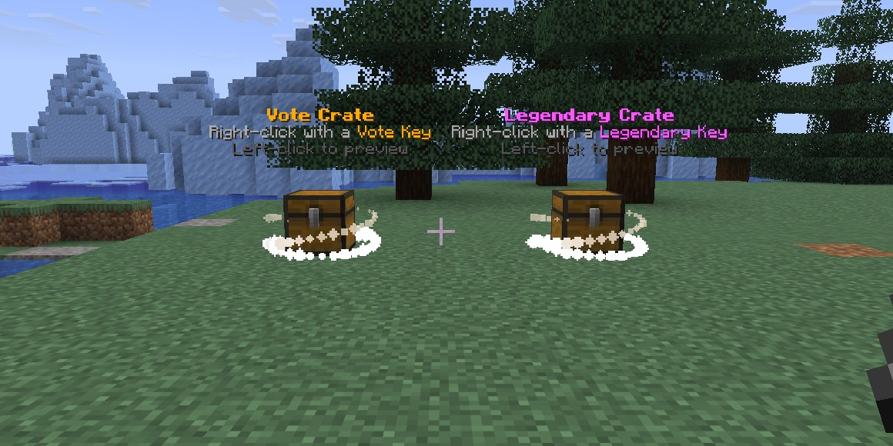
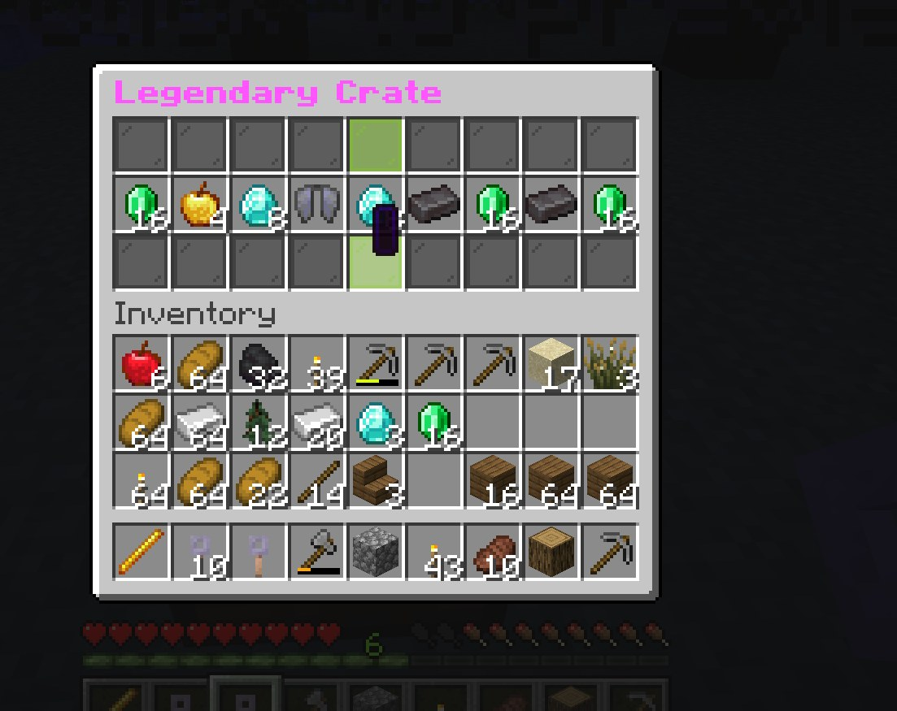
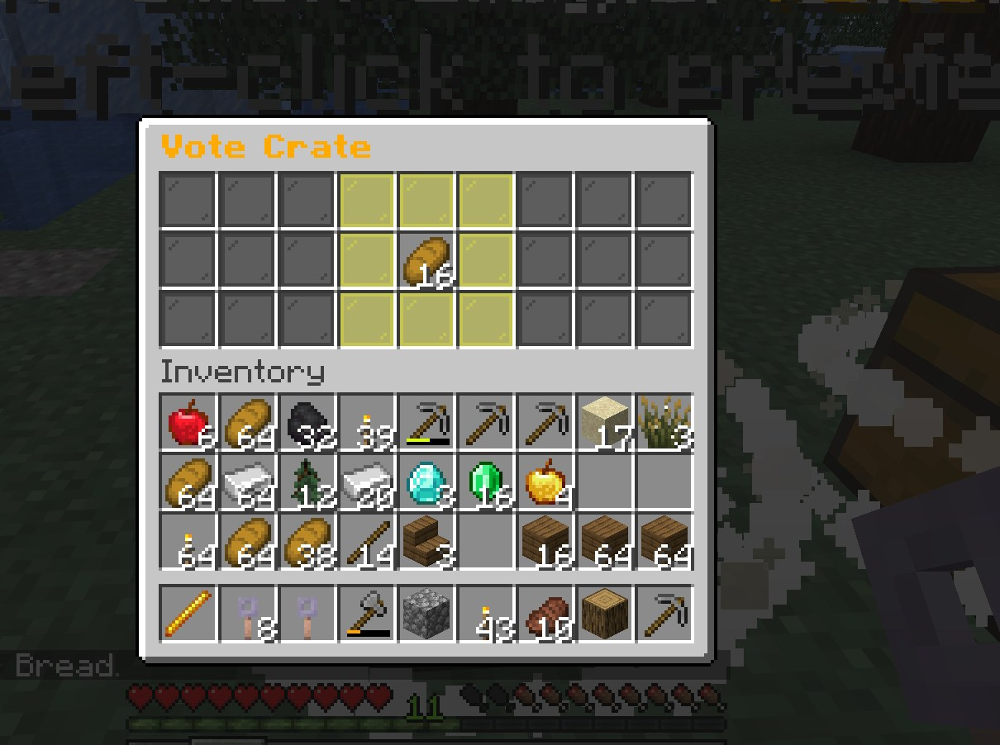
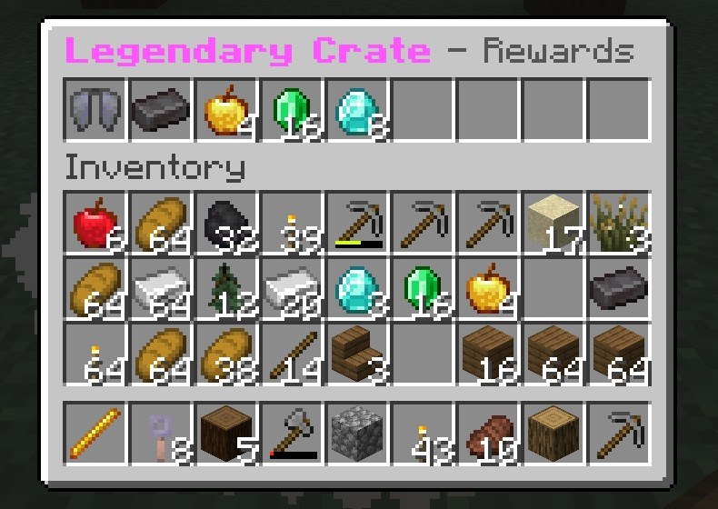
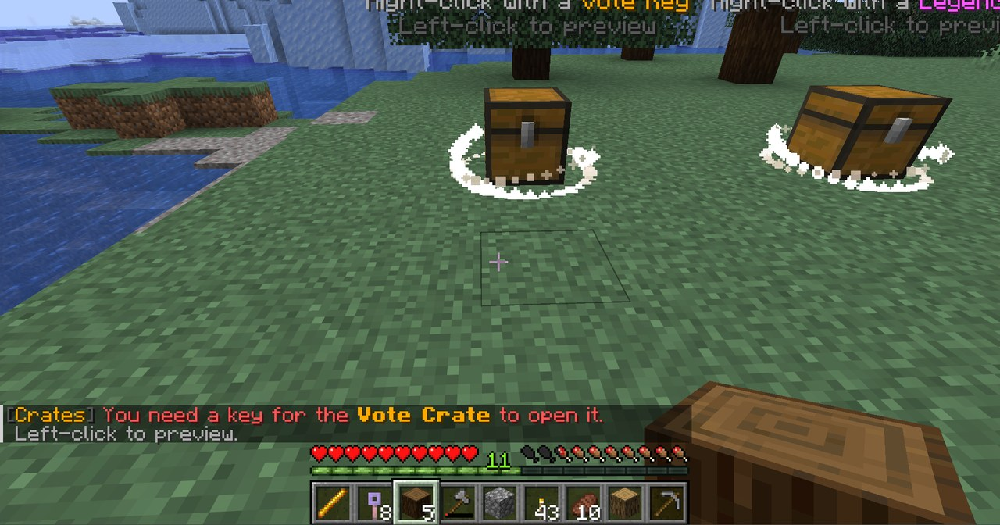

# Wintermark Crates

**Crates for Paper servers: keys, a rolling opening animation, reward chances, previews, holograms and particles.**
Turn any block into a crate with one command and fill it with items, money, ranks or other keys.



## Features

- **Any block can be a crate.** Look at it, `/crate set vote`. A hologram and a particle circle appear. Crate blocks can't be broken or blown up.
- **Rolling opening animation.** Rewards roll past a pointer, slow down and stop on the prize. The prize is decided before the roll starts and is always given, even if the player closes the menu or logs out.
- **Real keys.** Keys are items with a hidden tag, so renamed copies don't work. They can't be placed as blocks. Give them from the console, from vote plugins or from other plugins (for example [Wintermark AFK Zones](https://github.com/wintermarkinteractive/WintermarkAFKZones)).
- **Preview.** Left-click a crate to see every reward with its chance in percent, rarest first.
- **Rewards with chances.** Items and console commands (money, ranks, other keys...). Rare wins can be announced to the whole server.
- **Mass open.** Sneak + right-click opens all keys in your hand at once.
- **Fully configurable.** Crates, keys, rewards, holograms, particles, sounds and every message, with MiniMessage colors. New settings are added to your config automatically on updates.
- **Lightweight.** No dependencies. Holograms use display entities that are never saved into your world.

| Opening animation | The prize |
|---|---|
|  |  |

| Preview | Wrong key |
|---|---|
|  |  |

## Requirements

- **Paper 26.3** (or a Paper fork such as Purpur) with **Java 25**
- Not tested on Folia or Spigot

## Installation

1. Download `WintermarkCrates-1.0.0.jar` and put it in your server's `plugins` folder.
2. Start the server. `plugins/WintermarkCrates/config.yml` is created with two example crates (`vote` and `legendary`).
3. Place a block (a chest looks best), look at it and type `/crate set vote`.
4. `/crate givekey <player> vote 5` and right-click the crate.

Tip: place crates at least 4 blocks apart so their holograms don't overlap.

## Commands

Main command `/crate`, alias `/crates`.

| Command | Description | Permission |
|---|---|---|
| `/crate preview <crate>` | See the rewards and chances | `wintermark.crates.preview` |
| `/crate set <crate>` | Turn the block you look at into a crate | `wintermark.crates.admin` |
| `/crate remove` | Remove the crate you look at | `wintermark.crates.admin` |
| `/crate givekey <player> <crate> [amount]` | Give keys (works from the console) | `wintermark.crates.admin` |
| `/crate giveall <crate> [amount]` | Give keys to everyone online | `wintermark.crates.admin` |
| `/crate list` | All crates and where they are placed | `wintermark.crates.admin` |
| `/crate reload` | Reload `config.yml` | `wintermark.crates.admin` |

**Permissions**

| Permission | Default | Description |
|---|---|---|
| `wintermark.crates.use` | everyone | Open crates with a key |
| `wintermark.crates.preview` | everyone | Preview rewards |
| `wintermark.crates.admin` | op | Place and remove crates, give keys, reload |

## Configuration

The default config is commented line by line. The main sections:

```yaml
animation:        # enabled (false = instant rewards)
pushback: true    # push players back without the right key
mass-open-limit: 64
holograms:        # enabled, height
particles:        # enabled, type (END_ROD, FLAME, HAPPY_VILLAGER, ...)
sounds:           # tick, win, no-key
crates:           # your crates, see below
messages:         # every message
```

Example crate:

```yaml
crates:
  vote:
    name: "<gold><bold>Vote Crate</bold></gold>"
    hologram:
      - "<gold><bold>Vote Crate</bold></gold>"
      - "<gray>Right-click with a <gold>Vote Key</gold>"
    key:
      material: TRIPWIRE_HOOK
      name: "<gold>Vote Key"
      lore: ["<gray>Right-click the <gold>Vote Crate</gold> to open."]
      glow: true
    rewards:
      diamonds:
        chance: 7                    # relative weight, shown as % in the preview
        items: ["DIAMOND:3"]
        message: "<aqua>You won <reward>!"
      money:
        chance: 20
        display: "GOLD_NUGGET:1"     # item shown in the menus
        display-name: "<yellow>$500"
        commands: ["eco give <player> 500"]
        message: "<yellow>You won $500!"
      legendary-key:
        chance: 1
        display: "TRIPWIRE_HOOK:1"
        display-name: "<light_purple><bold>Legendary Key"
        commands: ["crate givekey <player> legendary 1"]
        broadcast: true              # announce to the whole server
```

Text uses [MiniMessage](https://docs.advntr.dev/minimessage/format.html). Placeholders: `<player>`, `<crate>`, `<reward>`, `<amount>`. Set any message to `""` to turn it off.

## FAQ

**How are chances calculated?**
`chance` is a weight. A reward with chance 7 in a crate where all chances add up to 100 has a 7% chance. The preview always shows the real percentage, so the numbers don't have to add up to 100.

**What happens if a player's inventory is full?**
The rest drops at their feet. Nothing is lost.

**Can I give keys from a vote plugin or another plugin?**
Yes. Run `crate givekey <player> <crate> 1` as a console command, for example as a vote reward or an AFK zone reward.

**Where is data stored?**
`config.yml` (crates) and `locations.yml` (where crates are placed) in `plugins/WintermarkCrates/`.

## Building from source

```
git clone https://github.com/wintermarkinteractive/WintermarkCrates.git
cd WintermarkCrates
./gradlew build
```

The jar is in `build/libs/`. Requires JDK 25.

## License

[MIT](LICENSE)

---

**Wintermark Interactive** - game mods, plugins and systems.
Designed, tested and maintained by Wintermark Interactive.
Custom plugins and server setups: wintermarkinteractive@gmail.com
